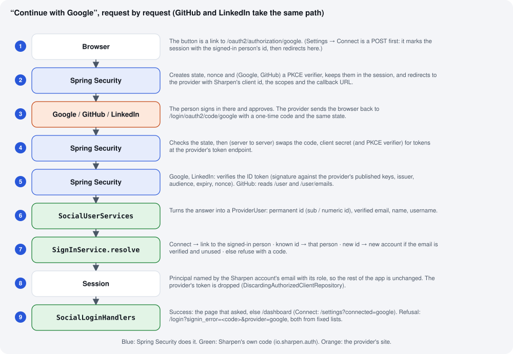

Sign in with Google, GitHub and LinkedIn
========================================

This page explains the whole feature in one place: what was set up at each provider and on the server, how a
sign-in travels through Sharpen request by request, which code makes each decision, what is stored, how it is
tested, and how to run it. The click-by-click console steps are in :doc:`../deployment/05-day-two` (*Sign in with
Google, GitHub and LinkedIn*); the dated story of how it went live is in :doc:`../deployment/09-pilot-log`
(day 23 and day 25).

At a glance
-----------

.. list-table::
   :header-rows: 1
   :widths: 22 26 26 26

   * -
     - Google
     - GitHub
     - LinkedIn
   * - Protocol
     - OpenID Connect (OAuth 2.0 + a signed ID token)
     - OAuth 2.0 only (no ID token)
     - OpenID Connect
   * - Provider app
     - Google Cloud project *Sharpen*, Google Auth Platform (External, *In production*), Web client
       *Sharpen website*
     - GitHub **OAuth App** *Sharpen* (not a GitHub App)
     - Developer app *Sharpen*, owned by the Sharpen Company Page, product *Sign In with LinkedIn using
       OpenID Connect*
   * - Callback (redirect) URL
     - ``https://sharpenscore.com/login/oauth2/code/google``
     - ``https://sharpenscore.com/login/oauth2/code/github``
     - ``https://sharpenscore.com/login/oauth2/code/linkedin``
   * - Scopes asked for
     - ``openid profile email``
     - ``read:user user:email``
     - ``openid profile email``
   * - Who the person is (stored as ``subject``)
     - the ID token's ``sub``
     - the numeric ``id`` from ``/user``
     - the ID token's ``sub``
   * - Email used
     - ``email`` when ``email_verified`` is true
     - from ``/user/emails``: the primary verified address, else any verified one
     - ``email`` when ``email_verified`` is true
   * - How Sharpen proves it is Sharpen
     - client secret in a Basic header
     - client secret in a Basic header
     - client secret in the form body (``client_secret_post``)
   * - PKCE
     - yes
     - yes
     - no (LinkedIn documents it for native apps only)
   * - Spring definition
     - ``CommonOAuth2Provider.GOOGLE``
     - ``CommonOAuth2Provider.GITHUB`` with the two scopes
     - spelled out in ``SocialRegistrations.linkedin``
   * - Status
     - live since day 23 (8 October 2026)
     - live since day 23
     - code live since day 25; switched on once the LinkedIn app exists

What was set up, and where
--------------------------

Nothing in the code names a real client id or secret. A provider exists for Sharpen only when its two values are
in the server's ``deploy/.env``; the chain from there to the code is:

.. list-table::
   :header-rows: 1
   :widths: 30 34 36

   * - ``deploy/.env`` on the A1
     - Container environment (``docker-compose.prod.yml``)
     - Spring property read by ``SocialRegistrations``
   * - ``GOOGLE_CLIENT_ID`` / ``GOOGLE_CLIENT_SECRET``
     - ``SHARPEN_OAUTH_GOOGLE_CLIENT_ID`` / ``_SECRET``
     - ``sharpen.oauth.google.client-id`` / ``client-secret``
   * - ``GITHUB_CLIENT_ID`` / ``GITHUB_CLIENT_SECRET``
     - ``SHARPEN_OAUTH_GITHUB_CLIENT_ID`` / ``_SECRET``
     - ``sharpen.oauth.github.client-id`` / ``client-secret``
   * - ``LINKEDIN_CLIENT_ID`` / ``LINKEDIN_CLIENT_SECRET``
     - ``SHARPEN_OAUTH_LINKEDIN_CLIENT_ID`` / ``_SECRET``
     - ``sharpen.oauth.linkedin.client-id`` / ``client-secret``

Missing or empty values mean "this provider is not offered": no button, and Spring will not start a sign-in
for it. With none set, ``SecurityConfig`` does not switch OAuth on at all and the site is exactly the password
site it was. A third property per provider, ``endpoint-base``, exists for the tests only (it points the
provider's addresses at a stand-in server); production never sets it.

The real values are kept in two places only: ``deploy/.env`` on the server and ``private/credentials.md`` on the
Mac (git-ignored, with a PDF copy made by ``private/make-pdf.py``). Google's downloaded client JSON is in
``private/`` too. A client **id** is not secret — it appears in every sign-in URL. A client **secret** is: with it,
someone could run a sign-in flow that looks like Sharpen's (each person would still have to press *Allow*, and
would only reveal their name and email). Both secrets were once shown in a chat or screenshot; the decision,
recorded in the pilot log, was to keep them and rotate if they ever appear anywhere else.

**The order it was done in** (day 23 for Google and GitHub, day 25 for LinkedIn):

#. Code first, with no provider configured — merged as PR #50 (plus the CodeQL redirect fix), so it could go live
   harmlessly before any provider app existed. The database change (``person_identity``, nullable
   ``password_hash``) went in with it as migration ``2026-10-08-sign-in-with.sql``.
#. **GitHub**: an OAuth App created at *Settings → Developer settings → OAuth Apps* (the first form opened was the
   *GitHub App* form, which is the wrong kind), callback as above, *Device Flow* off; the client id and a newly
   generated secret copied into ``private/credentials.md`` and ``deploy/.env``; ``dc up -d app``.
#. That restart brought back the September site, because Compose fell back to an old ``sharpen-app:local`` image.
   Fixed the same day: ``remote-deploy.sh`` now tags every image it deploys as ``sharpen-app:local``, so a plain
   restart keeps the deployed version (PR #52), and ``/api/v1/health`` reports the ``revision`` to check it.
#. **Google**: a new Cloud project *Sharpen* (the auto-created "API Project" left alone); Google Auth Platform with
   audience **External**, home page, privacy policy and authorised domain ``sharpenscore.com`` (already verified
   through Search Console), **no logo** (a logo starts a brand review); only the three non-sensitive scopes;
   **Publish app** to move it from *Testing* to *In production* (in *Testing* only listed test users can sign in,
   and only for seven days); a *Web application* client *Sharpen website* with one origin and one redirect URI;
   the JSON downloaded into ``private/``; values into ``deploy/.env``; ``dc up -d app``.
#. The admin account (a password account) connected both from *Settings → Sign-in methods*, so it now has three
   ways in.
#. **LinkedIn**: the code (PR #54) is live; the LinkedIn side — a Company Page, a developer app owned by it and
   verified, the OpenID Connect product, the redirect URL — is an open item in the pilot log. When it is done,
   the two values go into ``deploy/.env`` and ``dc up -d app`` switches the button on.

How a sign-in works
-------------------

Steps 2 to 5 are Spring Security's standard OAuth 2.0 / OpenID Connect client (``spring-boot-starter-security-
oauth2-client``); Sharpen only configures it. ``SecurityConfig.webChain`` adds ``oauth2Login`` to the browser
chain when ``SocialRegistrations`` is not empty, with four pieces of Sharpen's own:

.. list-table::
   :header-rows: 1
   :widths: 30 70

   * - Piece (``io.sharpen.auth``)
     - What it does
   * - ``SocialRegistrations``
     - The list of providers this deployment offers, built from the properties above. Implements Spring's
       ``ClientRegistrationRepository`` (Spring's own in-memory one refuses to be empty, which would break a site
       with no providers). Also gives the pages each provider's label for the buttons.
   * - ``SocialUserServices``
     - Runs after Spring has verified the provider's answer. ``oidc()`` handles Google and LinkedIn (the ID token
       is already checked; it reads ``sub``, ``email``, ``email_verified`` and the name); ``oauth2()`` handles
       GitHub (reads ``/user``, then calls ``/user/emails`` with the access token, because the profile's public
       ``email`` may be hidden or unverified). Both build a ``ProviderUser``, ask ``SignInService`` which Sharpen
       person this is, and return a principal **named by that person's Sharpen email** with role
       ``INDIVIDUAL`` or ``COMPANY`` — the same shape a password sign-in produces, so ``PersonService.current()``,
       role checks and every page work unchanged.
   * - ``SignInService``
     - The decisions (next section), the list for *Settings → Sign-in methods*, disconnecting, and the sentence
       shown for each refusal.
   * - ``SocialLoginHandlers``
     - Where the browser goes afterwards. Success: the page that asked for sign-in, else ``/dashboard``; after a
       *Connect*, ``/settings?connected=<provider>#sign-in``. Refusal: ``/login`` (or Settings) with
       ``?signin_error=<code>&provider=<id>``. Both values are replaced by Sharpen's own strings from fixed lists
       (a configured provider id; one of ``SocialLoginHandlers.CODES``) and URL-encoded, so nothing a visitor
       types can shape the redirect — the CodeQL finding on PR #50.
   * - ``DiscardingAuthorizedClientRepository``
     - Spring normally keeps each provider's access token in memory. Sharpen never calls a provider on the
       person's behalf after sign-in, so this keeps none: there is no token to leak.

The buttons are the ``socialButtons`` fragment in ``fragments.html`` — *Continue with …* on ``/login``, *Sign up
with …* on ``/register`` — one per configured provider (``GlobalModelAttributes.socialProviders``); each is a plain link to
``/oauth2/authorization/<provider>``. A refusal comes back as ``?signin_error=…``, which
``GlobalModelAttributes.signInError`` turns into the sentence from ``SignInService.message``.

Which account a sign-in belongs to
----------------------------------

``SignInService.resolve`` applies three rules, in this order:

.. list-table::
   :header-rows: 1
   :widths: 34 33 33

   * - Situation
     - Result
     - Refusal code (sentence shown)
   * - Started from *Settings → Connect* by a signed-in person
     - The provider account is linked to that person, whatever its email
     - ``identity_in_use`` if it is already linked to someone else; ``provider_already_linked`` if this person
       already has a different account of that provider; ``link_expired`` if the person no longer exists
   * - The provider account (by ``subject``) is linked to a person
     - Signs in as that person — even if the email at the provider has changed since
     - —
   * - New provider account, email verified by the provider, no Sharpen account with that email
     - A new **individual** account: email, name (the provider's full name, else its username, else the part
       before ``@``), a unique handle, a new API key, **no password**; plus the ``person_identity`` row
     - —
   * - New provider account, no verified email
     - Nothing is created
     - ``no_verified_email`` (for GitHub, with a pointer to GitHub's email settings)
   * - New provider account whose verified email a Sharpen account already uses
     - Nothing is created, nothing is merged
     - ``email_in_use`` — "sign in with your password, then connect it under Settings"
   * - The person pressed *Cancel* at the provider
     - —
     - ``access_denied``
   * - Anything else (provider down, bad token, unknown error)
     - —
     - ``failed``

**Why an existing account is never joined by email.** Sharpen has never verified the address typed at sign-up.
If a Google sign-in with ``alice@gmail.com`` were merged into an existing account with that email, someone could
register ``alice@gmail.com`` first with a password of their own, wait for Alice to arrive with Google, and keep
a way into her account. So a provider is joined to an existing account only from inside it (*Connect*), which
proves both sides. Matching on ``subject``, never on email, also means a changed or recycled email at the
provider cannot move a sign-in to a different person.

Settings → Sign-in methods
--------------------------

The card lists every offered provider with *Connect* or *Disconnect* (``SignInMethodsController``).

* **Connect** is a POST — so it carries the page's anti-forgery token and no other site can trigger it. It
  stores the person's id in the session under ``sharpen.oauth.link`` and redirects to
  ``/oauth2/authorization/<provider>``. When the provider sends the person back, ``SocialUserServices`` links
  instead of signing in, but only if the session flag is there **and** the session still belongs to that same
  person. The flag is used once and removed whether the sign-in succeeds or not.
* **Disconnect** deletes the ``person_identity`` row — unless it is the account's only way in (no password and no
  other provider), which is refused with a sentence saying why.

Accounts without a password
---------------------------

An account made through a provider has ``password_hash`` null (``Person.hasPassword()`` is false). Everywhere a
password matters handles that:

* The password form treats such an account as unknown (``SecurityConfig.userDetailsService`` filters it out), so
  it says "did not match" instead of revealing that the account signs in another way.
* *Settings → Password* shows "Set a password" with no "current password" field (``PersonService.changePassword``).
* *Delete account* is confirmed by typing the handle instead of the password
  (``AccountDeletionService.confirms``), and deletes the person's ``person_identity`` rows with everything else.
* The JSON export has a ``signIn`` section: whether a password is set, and each connected provider with the email
  and username it showed and when it was connected.

What is stored, and what is not
-------------------------------

One row per connected provider in ``person_identity`` (see :doc:`data-model`): ``person_id``, ``provider``,
``subject``, and the ``email`` and ``username`` the provider showed when it was connected — the last two only so
Settings can say *which* account is connected; they are never used to match. Not stored: access tokens, refresh
tokens, ID tokens, profile photos (Google and LinkedIn send a photo address; Sharpen ignores it), or anything else
from the provider. ``/privacy`` (*Signing in with Google, GitHub or LinkedIn*) says the same in plain words.

How it is tested
----------------

``SocialSignInTest`` starts the real application on a random port and a **stand-in provider** inside the test (a
small HTTP server playing Google, GitHub and LinkedIn — authorization, token, user-info, ``/user/emails`` and key
endpoints). The stand-in signs real ID tokens with a key it publishes, so Spring's signature, issuer, audience,
expiry and nonce checks run for real. The ``endpoint-base`` properties point the three providers at it.

.. list-table::
   :header-rows: 1
   :widths: 40 60

   * - Test
     - What it proves
   * - ``loginAndSignUpOfferTheConfiguredProviders``
     - *Continue with …* on ``/login`` and *Sign up with …* on ``/register`` for each configured provider, each a
       link to ``/oauth2/authorization/<provider>``.
   * - ``googleCreatesAnAccountWithTheNamesItGives``
     - A new Google account becomes an individual account with Google's names (handle ``grace-hopper``) and no
       password; Settings offers *Set a password*.
   * - ``githubCreatesAnAccountOnceAndSignsInAfterwards``
     - The private primary verified address from ``/user/emails`` is used; the second sign-in reuses the account.
   * - ``linkedinCreatesAnAccountTheLinkedInWay``
     - Scope ``openid profile email`` and a nonce but no PKCE challenge; the secret in the token request's body,
       no Basic header, no verifier.
   * - ``noAccountWithoutAVerifiedEmail``
     - Unverified email → ``no_verified_email``, nothing created.
   * - ``anExistingEmailIsNeverMergedAutomatically``
     - Existing email → ``email_in_use``, the existing account untouched.
   * - ``connectFromSettingsThenSignInWithIt``
     - Connect from Settings, then sign in with the provider from a fresh browser; someone else cannot connect the
       same provider account.
   * - ``theLastWayInStaysAndDeletionWorksWithoutAPassword``
     - The only way in cannot be disconnected; a password-less account deletes by handle.
   * - ``refusalsRedirectOnlyWithCheckedValues``
     - A hand-made callback with ``?error=x&next=https://evil.example/`` cannot add anything to the redirect.

The two security rules (verified email; no takeover through Connect) and the redirect rule were each proved by
removing them and watching their test fail. The suite also ran on PostgreSQL 16 against the migrated schema.

Running it
----------

**Switch a provider on or change its secret:** edit ``deploy/.env`` on the A1, then ``dc up -d app`` (the alias
is in ``~/.bashrc``; ``dc`` is not a program). The restart keeps the deployed version — check ``revision`` in
``curl -s https://sharpenscore.com/api/v1/health`` is unchanged — and ``/login`` shows the button.

**Rotate a secret:** GitHub: the OAuth App → *Generate a new client secret*, put it in ``.env``, restart, then
delete the old one. Google: the client → *Add secret*, switch, restart, then disable and delete the old one.
LinkedIn: *Auth* → generate a new primary secret. Update ``private/credentials.md`` and regenerate its PDF each
time.

**Switch a provider off:** remove its two lines from ``deploy/.env`` and restart. People who used it keep their
accounts; those without a password or another provider would need a password reset, which Sharpen does not have
yet (SE-10) — so prefer leaving a provider on once people use it.

**When something goes wrong:**

.. list-table::
   :header-rows: 1
   :widths: 40 60

   * - What you see
     - Why, and what to do
   * - No button for a provider
     - Its two values are missing from ``deploy/.env``, or the app was not restarted after editing it.
   * - ``redirect_uri_mismatch`` (Google), *redirect_uri is not associated* (GitHub), *does not match the
       registered value* (LinkedIn)
     - The callback URL in the provider's console differs from the table at the top by a character — ``https``,
       ``www`` or a trailing slash.
   * - LinkedIn ``unauthorized_scope_error``
     - The *Sign In with LinkedIn using OpenID Connect* product is not added to the LinkedIn app.
   * - Google "Access blocked: … has not completed the Google verification process", or only some people can sign in
     - The Google app is still in *Testing*: *Audience* → *Publish app*.
   * - "A Sharpen account already uses the email…"
     - Working as designed: sign in with the password and use *Settings → Connect*.
   * - 403 after pressing *Sign in* on a page left open across a restart
     - The form's anti-forgery token belonged to the old session: reload the page and try again.
   * - After a restart the site looks older
     - The restart used an old image. ``remote-deploy.sh`` prevents this since PR #52; check ``revision`` in
       ``/api/v1/health`` against the latest merge.

Where the code is
-----------------

* ``src/main/java/io/sharpen/auth/`` — ``SocialRegistrations``, ``SocialUserServices``, ``SignInService``,
  ``SocialLoginHandlers``, ``DiscardingAuthorizedClientRepository``
* ``config/SecurityConfig.java`` — ``oauth2Login`` on the browser chain; the password form ignores password-less
  accounts
* ``web/SignInMethodsController.java`` — Connect / Disconnect; ``web/GlobalModelAttributes.java`` — buttons and
  refusal sentences
* ``domain/PersonIdentity.java``, ``repo/PersonIdentityRepository.java``; migration
  ``db/migrations/2026-10-08-sign-in-with.sql``
* ``templates/fragments.html`` (``socialButtons``), ``login.html``, ``register.html``, ``settings.html``
  (``#sign-in``), ``privacy.html`` (``#providers``)
* ``src/test/java/io/sharpen/SocialSignInTest.java``
* Requirements: FR-6 in :doc:`../requirements/03-functional`, SE-13 in :doc:`../requirements/09-security-privacy`
